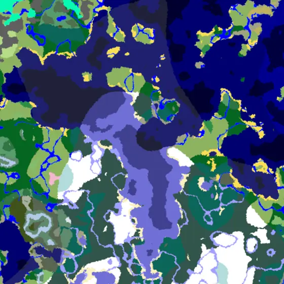
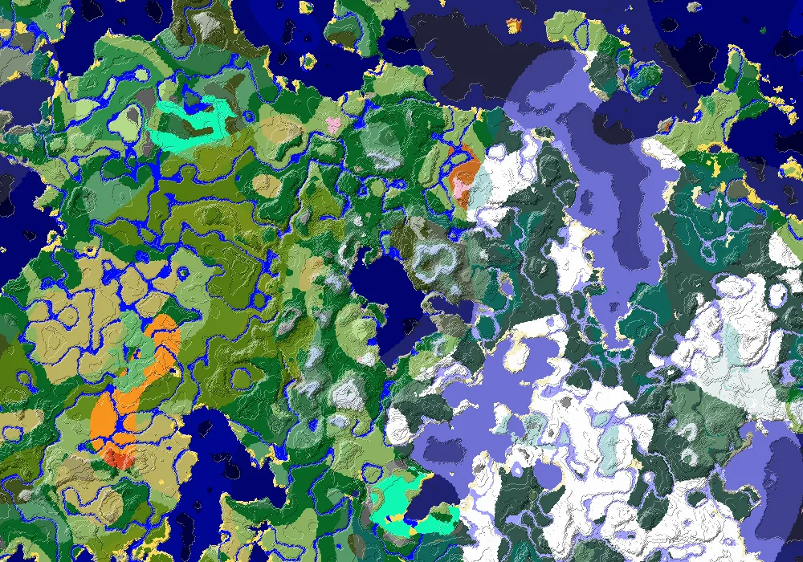
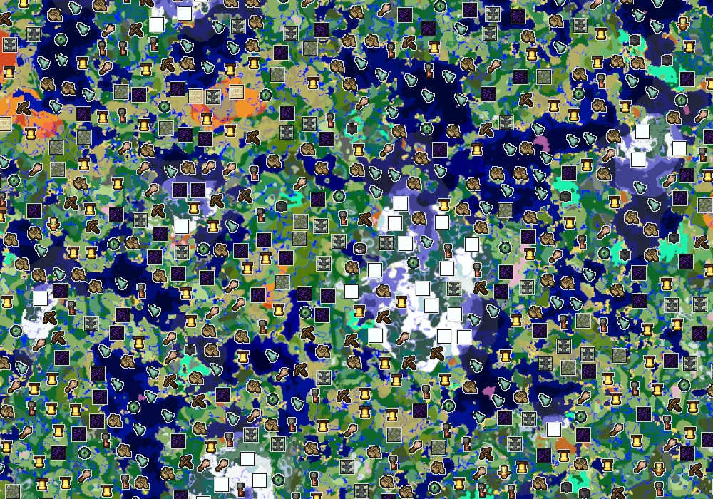
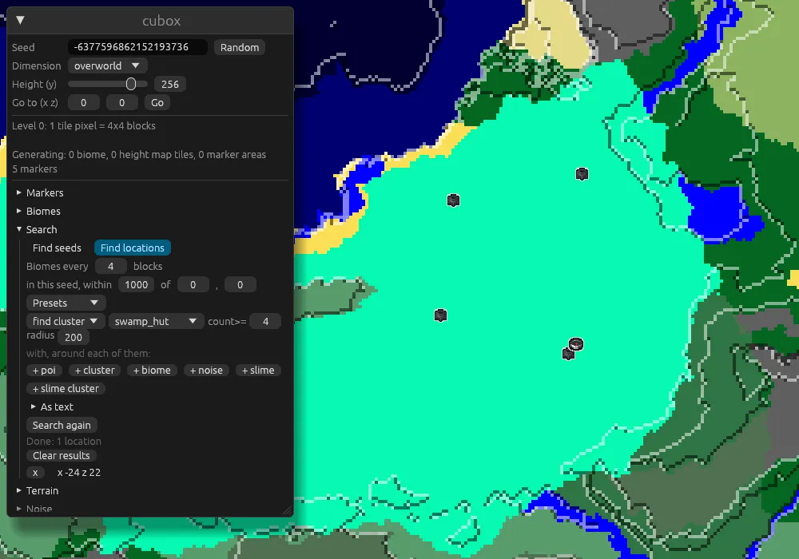
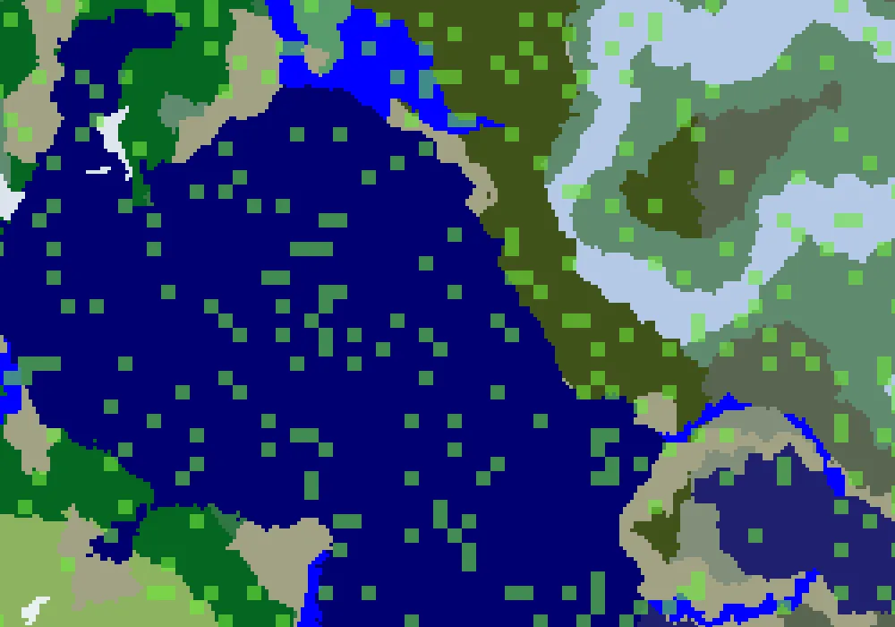
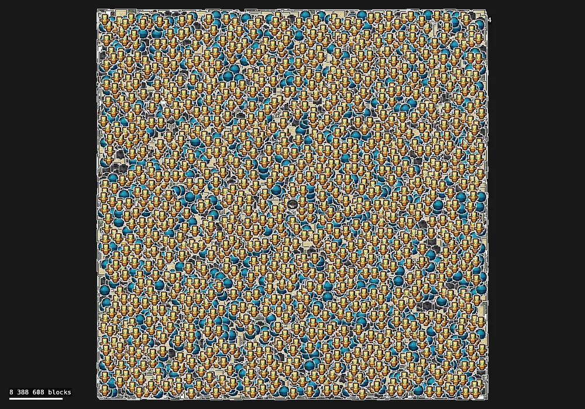
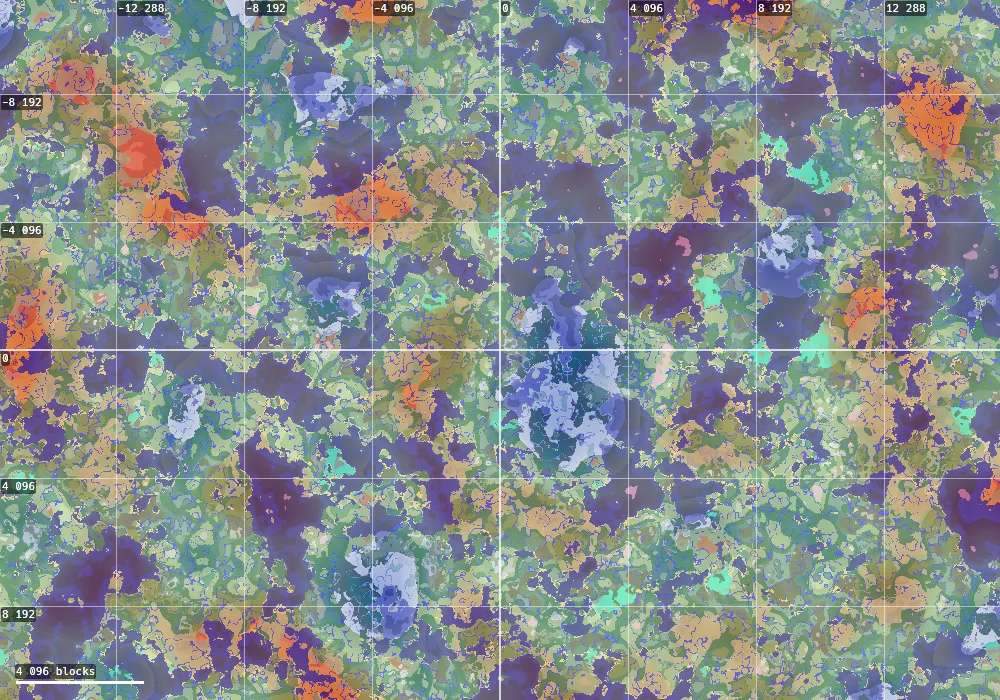
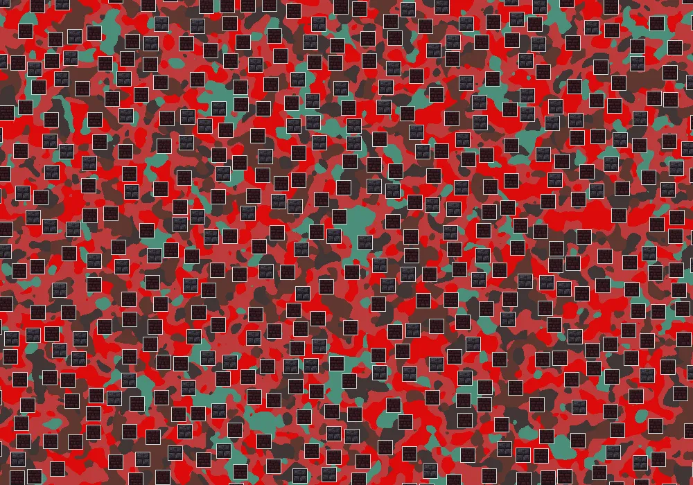
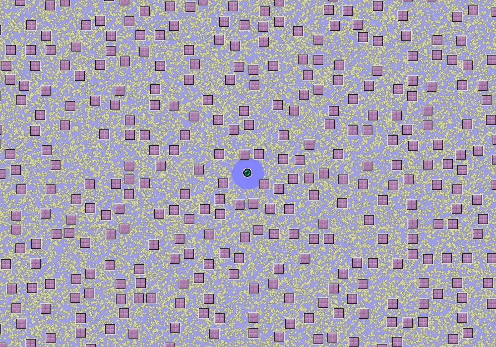

# cubox

**A 🔥🚀⚡BLAZINGLY FAST🔥🚀⚡ Minecraft seed viewer**

[](https://github.com/earomc/cubox/actions/workflows/ci.yml)
[](https://github.com/earomc/cubox/releases/latest)
[](LICENSE)

<p align="center"><b><a href="https://github.com/earomc/cubox/releases/latest">Download for desktop</a> · <a href="https://earomc.github.io/cubox">Try in your browser</a></b></p>

<p align="center">
  
</p>

cubox draws biomes, terrain and structures of any Minecraft seed using [SteelMC's](https://github.com/Steel-Foundation/SteelMC/)
world generator. SteelMC is a really cool project that you should check out! They rebuilt the Minecraft world generator from scratch in Rust. They basically did all the heavy backend work.
Huge thanks to them :)))

The name **cubox** is inspired by 'cubiomes' and the word oxidize (because of Rust, ha). And Minecraft is a game of
cubes/boxes ... so it works in multiple ways I guess ...

## Features

- **Fast, all the way out.** Pan and zoom smoothly from a few blocks to the entire world.
- **Structure locations**, from villages and strongholds to trial chambers and ancient cities, plus the spawn point, end gateways, geodes and large ore veins.
- **Find seeds** with custom conditions. You want two villages, a huge mushroom island, a cherry grove and a stronghold close by? You got it.
- **Find locations** in the seed you play: Quad witch huts, 9 slime chunks in a 3x3 area, or a pillager outpost next to an ocean. You can literally write your own (search) rules lol. See [seed search](docs/seed-search.md).
- **Overlays:** Highlight certain biomes, view noise maps, slime chunks and exact height maps with ravines, surface caves etc.
- **In your browser**. Even works on your phone or tablet with support for touch gestures!

## Screenshots
| Height map | Structures |
|---|---|
|  |  |
| **Find useful seeds and locations** | **Slime chunks** |
|  |  |
| **The whole Minecraft world in all its glory** | **Noise overlays (temperature in this example)** |
|  |  |
| **Nether** | **End** |
|  |  |

## Getting started

### Web version
The web version runs at **[earomc.github.io/cubox](https://earomc.github.io/cubox)**, in any current browser
(WebGPU where available, WebGL2 otherwise). You can add `?seed=replace_with_your_seed` to the address to open a specific seed. Useful for sharing a seed map in a Minecraft server community.
The web version doesn't currently support the seed search features. 
The newest commit on main, which may have problems, runs at [earomc.github.io/cubox/nightly](https://earomc.github.io/cubox/nightly/).

### Desktop / CLI

Get the latest build for your platform from the [releases page](https://github.com/earomc/cubox/releases/latest) or download below:

| Platform | Download |
|---|---|
| Windows (x86_64) | [cubox-x86_64-pc-windows-msvc.zip](https://github.com/earomc/cubox/releases/latest/download/cubox-x86_64-pc-windows-msvc.zip) |
| Windows (ARM64) | [cubox-aarch64-pc-windows-msvc.zip](https://github.com/earomc/cubox/releases/latest/download/cubox-aarch64-pc-windows-msvc.zip) |
| macOS (Intel and Apple Silicon) | [cubox-universal-apple-darwin.tar.gz](https://github.com/earomc/cubox/releases/latest/download/cubox-universal-apple-darwin.tar.gz) |
| Linux (x86_64) | [cubox-x86_64-unknown-linux-gnu.tar.gz](https://github.com/earomc/cubox/releases/latest/download/cubox-x86_64-unknown-linux-gnu.tar.gz) |
| Linux (ARM64) | [cubox-aarch64-unknown-linux-gnu.tar.gz](https://github.com/earomc/cubox/releases/latest/download/cubox-aarch64-unknown-linux-gnu.tar.gz) |

Unpack it and run `cubox` or `cubox.exe`.

- **Windows:** SmartScreen may warn about an unknown publisher, choose *More info → Run anyway*. It's not a virus, the binary is just not signed by Microsoft.
- **macOS:** Similar story here: The binary isn't signed. Right-click it and choose *Open* once, or run
  `xattr -d com.apple.quarantine cubox`.
- **Linux:** needs a Vulkan or OpenGL driver and an X11 or Wayland session - both available on most distros.

## Controls

| Key | Action |
|---|---|
| Arrow keys, or drag | Pan |
| + and −, or scroll, or pinch (mobile web) | Zoom the map |
| Right click, or long press (mobile web) | Menu of the map: copy a location or teleport command, go through a nether portal |
| Ctrl + and Ctrl −, Ctrl 0 | Scale the interface, reset its scale |
| Esc | Quit (only on desktop) |

## Command line

cubox provides a command line interface (CLI) for opening the GUI with certain parameters or generating map images. You can also use it to find seeds and locations.

```sh
cubox gui 12345 --dimension nether        # open the viewer with a seed and dimension
cubox gui "my cool world"                 # text seeds work like in Minecraft
cubox img -4172144997902289642            # negative seeds too
cubox img 12345 --level 6 --tiles 8       # render map.png: 8x8 tiles of 128 px, 1 px = 256 blocks
cubox img 12345 -d end --level 2 -y 64    # the end, 1 px = 16 blocks
cubox img 12345 -y -32                    # below the surface, with cave biomes
# seeds with two villages by spawn
cubox seeds "poi village count>=2 within 300 of spawn"
# every 2x2 square of slime chunks within 3000 blocks of 0,0
cubox locations 12345 --within 3000 "cluster slime count>=4 square 2"
cubox --help                              # everything else
```

`cubox gui --script file` drives the viewer from a script and saves screenshots, see
[`src/gui/script.rs`](src/gui/script.rs). The images above were made that way.

## More

- [Building from source](docs/building.md), including the web version, Docker, the structure icons and releasing
- [How it works](docs/how-it-works.md)

## Roadmap

- **World generation [features](https://minecraft.wiki/w/Feature)** like lava lakes and single ores as markers when zoomed in. SteelMC only places them while building real
  chunks, in a part of it that doesn't build for browsers, and most positions can't be known without that.
- **Large biomes** world type and custom worldgen with datapacks, once SteelMC's world generator supports that.
- macOS app bundle and code signing, and a Windows build without a console window.

## Credits

- [SteelMC](https://github.com/Steel-Foundation/SteelMC/) for the world generator that does all the heavy lifting.
- Inspired by [cubiomes](https://github.com/Cubitect/cubiomes), [cubiomes viewer](https://github.com/Cubitect/cubiomes-viewer),
  [amidst](https://github.com/toolbox4minecraft/amidst) and [chunkbase](https://www.chunkbase.com/apps/seed-map).

## Use of AI

cubox's code was largely written by Claude Code. Functionality and some of the code were manually reviewed and iterated over by using my own brain. This README was manually reviewed and edited by me (earomc) too.

## License

Hosting cubox? Keep the license notice in its settings window. If you changed anything, offer your changes to its users
too: set `repository` in `Cargo.toml` to your source, the notice links to it.

cubox is free software under the [GNU Affero General Public License v3.0 or later](LICENSE), inheriting SteelMC's license.

The structure icons in [`assets/icons`](assets/icons/NOTICE) are Minecraft textures owned by Mojang and Microsoft, used
under the [Minecraft Usage Guidelines](https://www.minecraft.net/en-us/usage-guidelines) and not covered by the AGPL.
As an additional permission under section 7 of the AGPL, you may combine cubox with those textures and convey the
result.

**NOT AN OFFICIAL MINECRAFT PRODUCT. NOT APPROVED BY OR ASSOCIATED WITH MOJANG OR MICROSOFT.** cubox is made and
maintained by earomc. Questions and problems go to the [issue tracker](https://github.com/earomc/cubox/issues).
