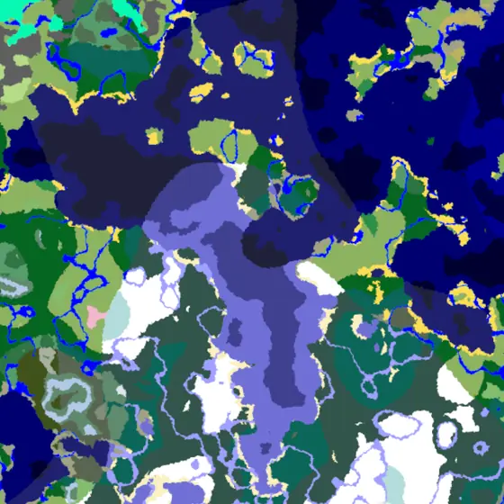
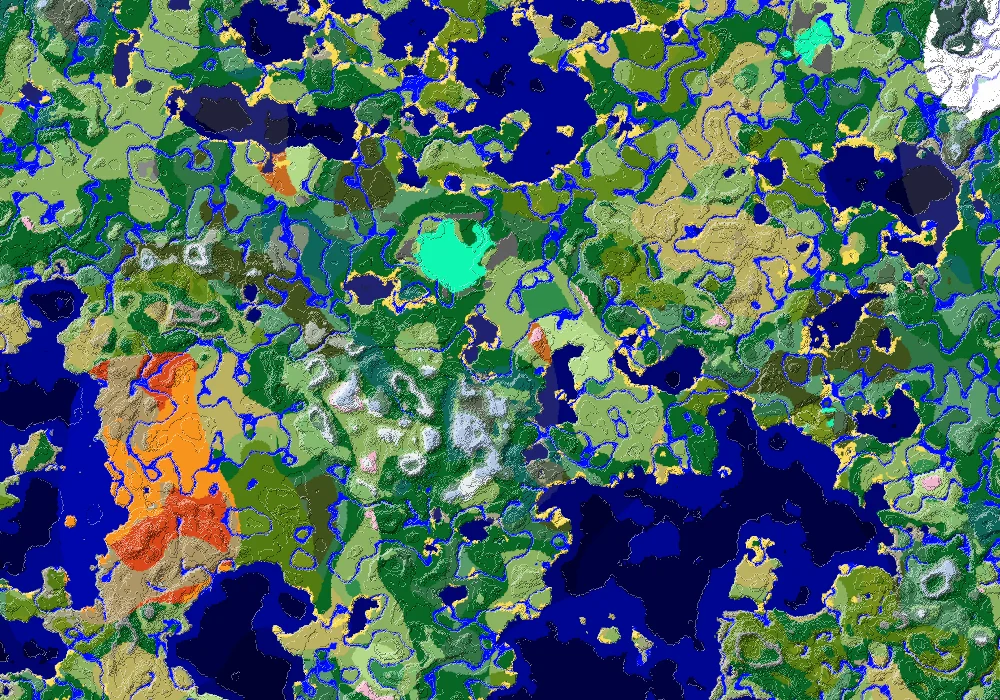
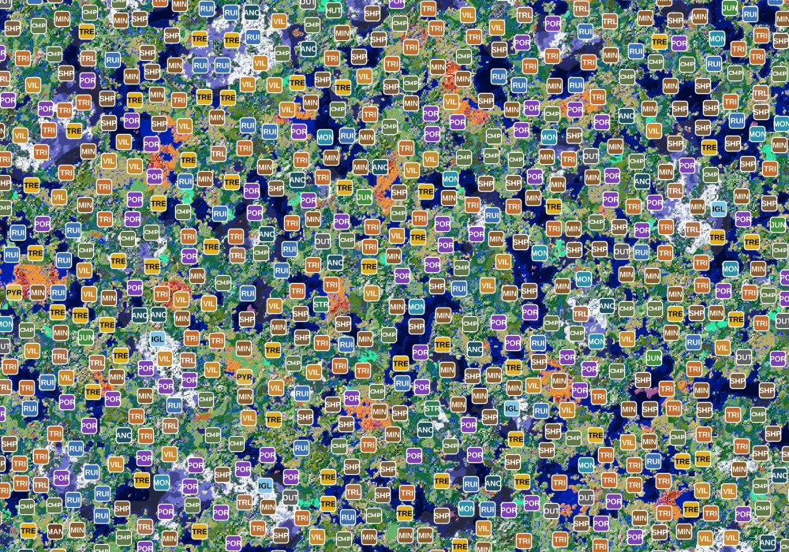
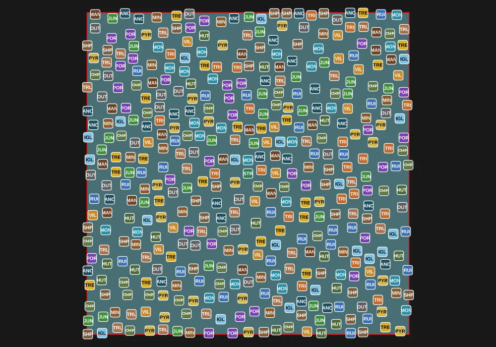
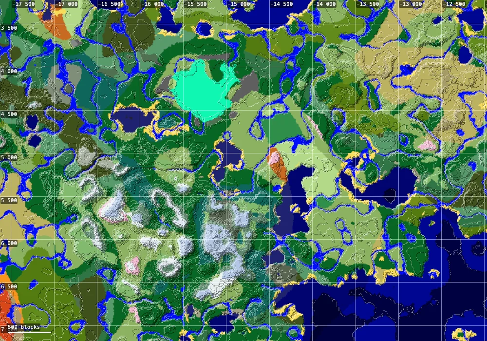
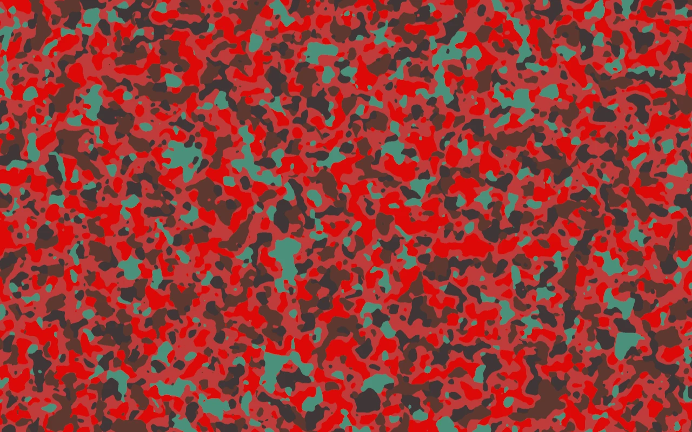
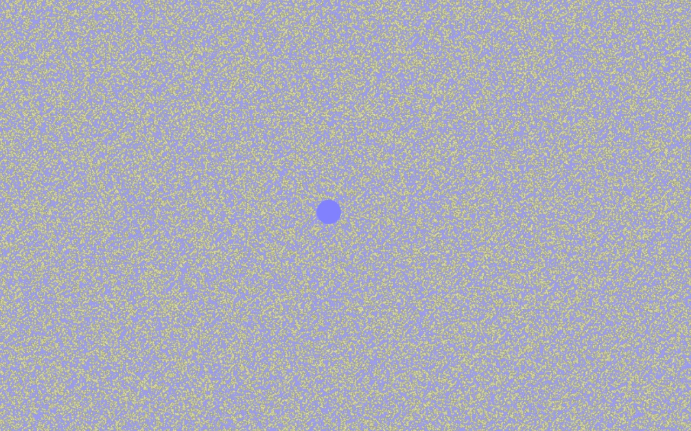

# cubox

**A super fast Minecraft seed viewer, from 4×4 block quarts out to the whole world.**

[](https://github.com/earomc/cubox/actions/workflows/ci.yml)
[](https://github.com/earomc/cubox/releases/latest)
[](LICENSE)

<p align="center"><b><a href="https://earomc.github.io/cubox">Try it in your browser</a></b> · <a href="https://github.com/earomc/cubox/releases/latest">Download for desktop</a></p>

<p align="center">
  
  <br>
  <sub>Overworld, nether and end, from single biome cells out to the whole world.</sub>
</p>

cubox draws the biomes, terrain and structures of any Minecraft seed using [SteelMC's](https://github.com/Steel-Foundation/SteelMC/)
world generator. SteelMC is a really cool project that you should check out! They basically did all the work ahahah.
Huge thanks to them :)))

The name **cubox** is inspired by 'cubiomes' and the word oxidize (because of Rust, ha). And Minecraft is a game of
cubes/boxes ... so it works in multiple ways I guess ...

## Features

| Height map | Structures |
|---|---|
|  |  |
| **The whole world** | **Distance grid** |
|  |  |
| **Nether** | **End** |
|  |  |

**The map**

- **Smooth pan and zoom** from quarts, the 4×4 block cells biomes are generated in, out to the entire 60 million
  block world.
- **Accurate colors at every zoom level.** Zoomed out, every pixel shows the average color of the area it covers,
  blended in a perceptual color space. Each zoom level is calibrated against the real world, so the map has exactly
  as much contrast as the true view: crisp up close, an honest haze where a pixel covers thousands of biomes.
- **Overworld, nether and end**, with the height to sample biomes at (sample below the surface to find caves).
- **Height map** of the terrain in the overworld, sea floor included, with one visible square per height. It uses the
  game's quick estimate of the surface, usually 5 to 15 blocks off, and can switch to exact heights when zoomed in.
- **Distance grid** with block coordinates and a scale bar, with automatic or fixed spacing.

**Finding things**

- **All structures in the game**, each with its own icon and switch. Positions come from the game's real generation
  code, including biome and terrain checks.
- **At every zoom:** close up all of them, far out a steady number of real ones that fills the screen. You choose the
  space between markers, or let them overlap and set how many to show. Rare kinds come first if you like.
- **Search** for the nearest structures or biomes from the middle of the view.
- **Seeds like in Minecraft:** numbers, negative ones too, or any text, turned into the same seed the game uses.
- **Go to coordinates**, and the biome and height under the cursor.

**Everywhere, and fast**

- **Fast:** everything is generated in the background on all cores, centre first, with quick previews while you zoom.
  How many threads and how much memory it may use is up to you.
- **Runs in the browser** too, through web workers, with pinch to zoom and an on screen keyboard on touch screens.
- **Image export** from the command line.

## Download

The web version runs at **[earomc.github.io/cubox](https://earomc.github.io/cubox)**, in any current browser
(WebGPU where available, WebGL2 otherwise). Add `?seed=hello&dimension=nether` to the address to open a world.
The newest commit on main, which may be broken, runs at [earomc.github.io/cubox/nightly](https://earomc.github.io/cubox/nightly/).

Get the latest build for your platform from the [releases page](https://github.com/earomc/cubox/releases/latest):

| Platform | Download |
|---|---|
| Windows (x86_64) | [cubox-x86_64-pc-windows-msvc.zip](https://github.com/earomc/cubox/releases/latest/download/cubox-x86_64-pc-windows-msvc.zip) |
| Windows (ARM64) | [cubox-aarch64-pc-windows-msvc.zip](https://github.com/earomc/cubox/releases/latest/download/cubox-aarch64-pc-windows-msvc.zip) |
| macOS (Intel and Apple Silicon) | [cubox-universal-apple-darwin.tar.gz](https://github.com/earomc/cubox/releases/latest/download/cubox-universal-apple-darwin.tar.gz) |
| Linux (x86_64) | [cubox-x86_64-unknown-linux-gnu.tar.gz](https://github.com/earomc/cubox/releases/latest/download/cubox-x86_64-unknown-linux-gnu.tar.gz) |
| Linux (ARM64) | [cubox-aarch64-unknown-linux-gnu.tar.gz](https://github.com/earomc/cubox/releases/latest/download/cubox-aarch64-unknown-linux-gnu.tar.gz) |

Unpack it and run `cubox`. Each release also lists SHA-256 checksums.

- **Windows:** SmartScreen may warn about an unknown publisher, choose *More info → Run anyway*.
- **macOS:** the binary isn't signed yet. Right-click it and choose *Open* once, or run
  `xattr -d com.apple.quarantine cubox`.
- **Linux:** needs a Vulkan or OpenGL driver and an X11 or Wayland session.

## Controls

| Key | Action |
|---|---|
| Arrow keys, or drag | Pan |
| + and −, or scroll, or pinch | Zoom the map |
| Ctrl + and Ctrl −, Ctrl 0 | Scale the interface, reset its scale |
| Esc | Quit (desktop) |

## Command line

```sh
cubox gui 12345 --dimension nether        # open the viewer with a seed and dimension
cubox gui "my cool world"                 # text seeds work like in Minecraft
cubox img -4172144997902289642            # negative seeds too
cubox img 12345 --scale 6 --tiles 8       # render map.png: 8x8 tiles of 128 px, 1 px = 256 blocks
cubox img 12345 -d end --scale 2 -y 64    # the end, 1 px = 16 blocks
cubox --help                              # everything else
```

`--scale` is the zoom level: each pixel covers 2<sup>scale</sup> quarts (4×4 blocks) per side. `--samples` sets the
samples per pixel and axis, and `--exact` shows the raw sampled averages without the calibrated shading.

`cubox gui --script file` drives the viewer from a script and saves screenshots, see
[`src/gui/script.rs`](src/gui/script.rs). The images above were made that way.

## Structure icons

The icons are the PNG files in [`assets/icons`](assets/icons), named after each structure, 32x32 pixels
with transparency. To change one, replace its file and rebuild. The current ones are placeholders.

## How it works

The map is a pyramid of 128×128 px tiles: level *n* has 2<sup>n</sup> quarts per pixel. The viewer shows the level
whose pixels are closest to screen pixels and generates missing tiles in the background. A coarser tile is built from
four finer ones when they exist, which costs no sampling at all.

Each pixel averages several biome samples spread over its area. Up close that is the exact biome map. Far out a
pixel covers thousands of biomes and its few samples are mostly noise, so shown as is the map would look like
confetti. cubox measures, per world and zoom level, how much the true area averages vary and how far the samples are
off, and pulls the samples toward the world's average color just enough that the map varies as much as the real
averages do. That's why zooming out ends in a uniform blue-green: the whole world averaged.

## Building from source

You need [rustup](https://rustup.rs). SteelMC's world generator uses nightly Rust features, the right nightly is
pinned in [`rust-toolchain.toml`](rust-toolchain.toml) and installed automatically.

```sh
git clone https://github.com/earomc/cubox
cd cubox
cargo run --release
```

On Linux, building needs no extra system packages. The first build downloads Minecraft's data for SteelMC.

### Web version

```sh
cargo install wasm-bindgen-cli --version 0.2.129 --locked   # the version of wasm-bindgen in Cargo.lock
./scripts/build-web.sh                                       # builds into dist/
python3 -m http.server --directory dist                      # or any static file server
```

`wasm-opt` from [binaryen](https://github.com/WebAssembly/binaryen) is used when installed, it makes the wasm smaller
and faster. Distributions often ship versions too old for current wasm, `scripts/install-wasm-opt.sh` installs a release.

cubox uses SteelMC with [one commit on top](https://github.com/earomc/SteelMC/tree/cubox-locate-only-26.3) that makes
finding jigsaw structures much faster, until it is upstream. For the browser it uses a copy of simdnbt that allows 32-bit targets
([`vendor/simdnbt`](vendor/simdnbt/CUBOX.md)).

### Docker

```sh
docker compose up --build
```

builds the web version and serves it at http://localhost:8080 with nginx. The image only contains the static
files, so any static host works too.

## Releasing

1. Bump `version` in `Cargo.toml` and move the changes in [`CHANGELOG.md`](CHANGELOG.md) under a new
   `## [x.y.z] - date` heading.
2. Commit, then tag and push: `git tag vx.y.z && git push origin main vx.y.z`.

The [release workflow](.github/workflows/release.yml) builds all platforms and publishes the release, with the
changelog section as release notes. The [pages workflow](.github/workflows/pages.yml) deploys the web version to
GitHub Pages on every tag and every push to main: the latest release at the root and main at `/nightly/`.

## Roadmap

- **Features** like lava lakes, geodes and ores as markers when zoomed in. SteelMC only places them while building real
  chunks, in a part of it that doesn't build for browsers, and most positions can't be known without that.
- **Large biomes** worlds, once SteelMC's world generator supports them.
- macOS app bundle and code signing, and a Windows build without a console window.

## Credits

- [SteelMC](https://github.com/Steel-Foundation/SteelMC/) for the world generator that does all the heavy lifting.
- Inspired by [cubiomes](https://github.com/Cubitect/cubiomes), [cubiomes viewer](https://github.com/Cubitect/cubiomes-viewer),
  [amidst](https://github.com/toolbox4minecraft/amidst) and [chunkbase](https://www.chunkbase.com/apps/seed-map).

## License

Hosting cubox? Keep the license notice in its settings window. If you changed anything, offer your changes to its users
too: set `repository` in `Cargo.toml` to your source, the notice links to it.

cubox is free software under the [GNU Affero General Public License v3.0 or later](LICENSE), like SteelMC.
