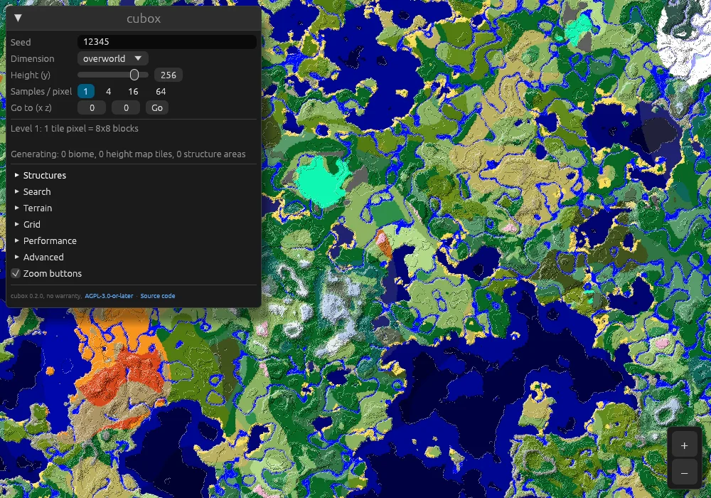
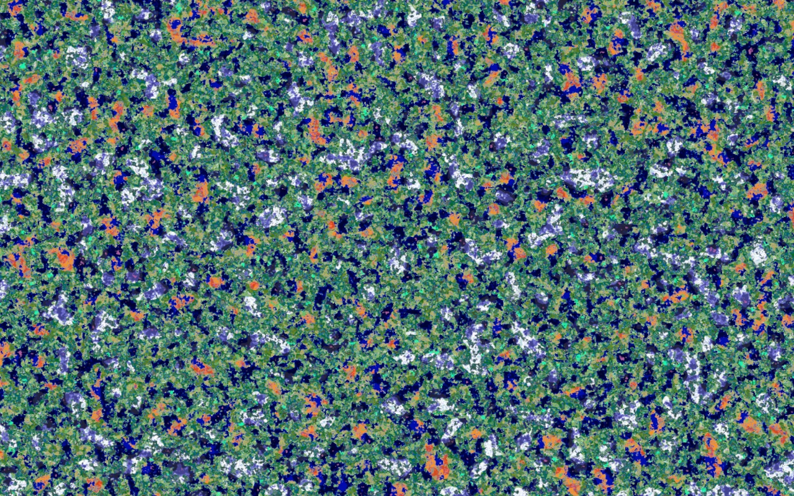

# cubox

**A super fast Minecraft seed viewer, from single blocks out to the whole world.**

[](https://github.com/earomc/cubox/actions/workflows/ci.yml)
[](https://github.com/earomc/cubox/releases/latest)
[](LICENSE)

<p align="center">
  
</p>

cubox draws the biome map of any Minecraft seed using [SteelMC's](https://github.com/Steel-Foundation/SteelMC/)
world generator. SteelMC is a really cool project that you should check out! They basically did all the work ahahah.
Huge thanks to them :)))

The name **cubox** is inspired by 'cubiomes' and the word oxidize (because of Rust, ha). And Minecraft is a game of
cubes/boxes ... so it works in multiple ways I guess ...

## Features

- **Smooth pan and zoom** from single quarts (4×4 blocks) out to the entire 60 million block world.
- **Accurate colors at every zoom level.** Zoomed out, every pixel shows the average color of the area it covers,
  blended in a perceptual color space. Each zoom level is calibrated against the real world, so the map has exactly
  as much contrast as the true view: crisp up close, an honest haze where a pixel covers thousands of biomes.
- **Overworld, nether and end**, with the height to sample biomes at (sample below the surface to find caves).
- **Go to coordinates** and the biome under the cursor.
- **Fast:** tiles are generated on all cores, centre first, with quick coarse previews while you zoom.
  Work for tiles that leave the screen is cancelled.
- **Image export** from the command line.

| Overworld | Zoomed out |
|---|---|
|  |  |
| **Nether** | **End** |
|  |  |

## Download

Get the latest build for your platform from the [releases page](https://github.com/earomc/cubox/releases/latest):

| Platform | Download |
|---|---|
| Windows (x86_64) | [cubox-x86_64-pc-windows-msvc.zip](https://github.com/earomc/cubox/releases/latest/download/cubox-x86_64-pc-windows-msvc.zip) |
| Windows (ARM64) | [cubox-aarch64-pc-windows-msvc.zip](https://github.com/earomc/cubox/releases/latest/download/cubox-aarch64-pc-windows-msvc.zip) |
| macOS (Intel and Apple Silicon) | [cubox-universal-apple-darwin.tar.gz](https://github.com/earomc/cubox/releases/latest/download/cubox-universal-apple-darwin.tar.gz) |
| Linux (x86_64) | [cubox-x86_64-unknown-linux-gnu.tar.gz](https://github.com/earomc/cubox/releases/latest/download/cubox-x86_64-unknown-linux-gnu.tar.gz) |
| Linux (ARM64) | [cubox-aarch64-unknown-linux-gnu.tar.gz](https://github.com/earomc/cubox/releases/latest/download/cubox-aarch64-unknown-linux-gnu.tar.gz) |

Unpack it and run `cubox`. Each release also lists SHA-256 checksums.

- **Windows:** SmartScreen may warn about an unknown publisher, choose *More info → Run anyway*.
- **macOS:** the binary isn't signed yet. Right-click it and choose *Open* once, or run
  `xattr -d com.apple.quarantine cubox`.
- **Linux:** needs a Vulkan or OpenGL driver and an X11 or Wayland session.

## Usage

Run `cubox` to open the viewer.

| Action | Control |
|---|---|
| Pan | drag with the mouse |
| Zoom | scroll wheel or pinch, around the cursor |
| Change seed, dimension, height, samples | the *cubox* window (collapse it with the arrow) |
| Jump somewhere | *Go to (x z)*, then *Go* or Enter |
| Quit | Esc |

*Samples / pixel* trades speed for detail: far out, more samples show more of the real variation instead of haze.

### Command line

```sh
cubox gui 12345 --dimension nether        # open the viewer with a seed and dimension
cubox img 12345 --scale 6 --tiles 8       # render map.png: 8x8 tiles of 128 px, 1 px = 256 blocks
cubox img 12345 -d end --scale 2 -y 64    # the end, 1 px = 16 blocks
cubox --help                              # everything else
```

`--scale` is the zoom level: each pixel covers 2<sup>scale</sup> quarts (4×4 blocks) per side. `--samples` sets the
samples per pixel and axis, and `--exact` shows the raw sampled averages without the calibrated shading.

`cubox gui --script file` drives the viewer from a script and saves screenshots, see
[`src/gui/script.rs`](src/gui/script.rs). The images above were made that way.

## How it works

The map is a pyramid of 128×128 px tiles: level *n* has 2<sup>n</sup> quarts per pixel. The viewer shows the level
whose pixels are closest to screen pixels and generates missing tiles in the background. A coarser tile is built from
four finer ones when they exist, which costs no sampling at all.

Each pixel averages several biome samples spread over its area. Up close that is the exact biome map. Far out a
pixel covers thousands of biomes and its few samples are mostly noise, so shown as is the map would look like
confetti. cubox measures, per world and zoom level, how much the true area averages vary and how far the samples are
off, and pulls the samples toward the world's average color just enough that the map varies as much as the real
averages do. That's why zooming out ends in a uniform blue-green: the whole world averaged.

## Building from source

You need [rustup](https://rustup.rs). SteelMC's world generator uses nightly Rust features, the right nightly is
pinned in [`rust-toolchain.toml`](rust-toolchain.toml) and installed automatically.

```sh
git clone https://github.com/earomc/cubox
cd cubox
cargo run --release
```

On Linux, building needs no extra system packages.

## Releasing

1. Bump `version` in `Cargo.toml` and move the changes in [`CHANGELOG.md`](CHANGELOG.md) under a new
   `## [x.y.z] - date` heading.
2. Commit, then tag and push: `git tag vx.y.z && git push origin main vx.y.z`.

The [release workflow](.github/workflows/release.yml) builds all platforms and publishes the release, with the
changelog section as release notes.

## Roadmap

- **Structures:** find villages, strongholds, monuments and other structures, and search the world for them.
- **Web version:** cubox renders with wgpu, which also runs in the browser through WebGPU/WebGL.
- macOS app bundle and code signing, and a Windows build without a console window.

## Credits

- [SteelMC](https://github.com/Steel-Foundation/SteelMC/) for the world generator that does all the heavy lifting.
- Inspired by [cubiomes](https://github.com/Cubitect/cubiomes), [cubiomes viewer](https://github.com/Cubitect/cubiomes-viewer),
  [amidst](https://github.com/toolbox4minecraft/amidst) and [chunkbase](https://www.chunkbase.com/apps/seed-map).

## License

cubox is free software under the [GNU Affero General Public License v3.0 or later](LICENSE), like SteelMC.
